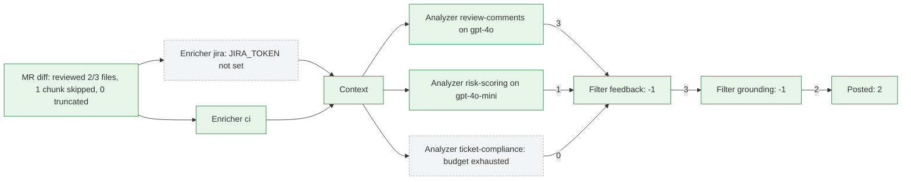

## Karandash Compliance: FAILED

> **⚠️ Risk Assessment** (score: 72)
>
> Large change touching payment code

| Severity | Count |
|----------|-------|
| Error | 1 |
| Warning | 1 |
| Info | 1 |

### Findings

| Severity | Rule | Message | How to fix |
|----------|------|---------|------------|
| ❌ ERROR | `labels` | Missing required label: 'needs-review'  ℹ️ Labels route MRs through review. | Add the label via the MR sidebar. |
| ⚠️ WARNING | `aiReview` | The retry loop never backs off |  |
| ℹ️ INFO | `style` | Line one line two with a \| pipe |  |

### Compliance Checklist

_AI coverage: reviewed 2/3 files, 1 chunk skipped, 0 truncated_

How this review was made

**Coverage:** reviewed 2/3 files, 1 chunk skipped, 0 truncated

| Enricher | Status | Details |
|---|---|---|
| `jira` | skipped | JIRA_TOKEN not set |
| `ci` | ok | ~120 tokens |

| Analyzer | Model | Tokens in/out | Cost | Findings |
|---|---|---|---|---|
| `review-comments` | `gpt-4o` | 9000/800 | $0.0310 | 3 |
| `risk-scoring` | `gpt-4o-mini` | 1200/60 | $0.0004 | 1 |
| `ticket-compliance` | skipped: budget exhausted | 0/0 | $0.0000 | 0 |

| Filter | Removed |
|---|---|
| feedback | 1 |
| grounding | 1 |

---
_Generated by [karandash](https://github.com/karandash/karandash) · React 👎 on a finding to mark it as a false positive._
