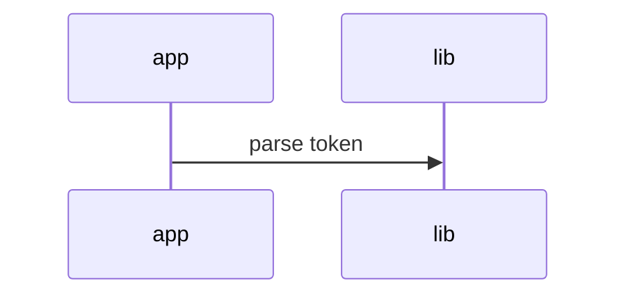

## Проверка Karandash: ПРОЙДЕНА

### Сводка изменений

Adds login.

Обзор изменений

| Unit | Files | Lines |
|---|---|---|
| `app` | `src/main/Login.kt` | +10/-2 |
| `lib` | `src/Parser.kt` | +1/-1 |

| Серьёзность | Количество |
|----------|-------|
| Ошибки | 0 |
| Предупреждения | 1 |
| Информация | 0 |

### Замечания

| Серьёзность | Правило | Сообщение | Как исправить |
|----------|------|---------|------------|
| ⚠️ WARNING | `r` | Null check missing |  |

### Чек-лист соответствия

_Покрытие AI: проверено файлов: 2/3, пропущен 1 фрагмент, обрезано: 0_

Как проводилась проверка

**Покрытие:** проверено файлов: 2/3, пропущен 1 фрагмент, обрезано: 0

| Обогащение | Статус | Подробности |
|---|---|---|
| `jira` | пропущено | JIRA_TOKEN not set |
| `ci` | ок | ~120 токенов |

| Анализатор | Модель | Токены вход/выход | Стоимость | Замечания |
|---|---|---|---|---|
| `review-comments` | `gpt-4o` | 9000/800 | $0.0310 | 3 |
| `risk-scoring` | `gpt-4o-mini` | 1200/60 | $0.0004 | 1 |
| `ticket-compliance` | пропущено: бюджет исчерпан | 0/0 | $0.0000 | 0 |

| Фильтр | Удалено |
|---|---|
| feedback | 1 |
| grounding | 1 |

---
_Создано [karandash](https://github.com/karandash/karandash) · Поставьте 👎 замечанию, чтобы отметить его как ложное срабатывание._
