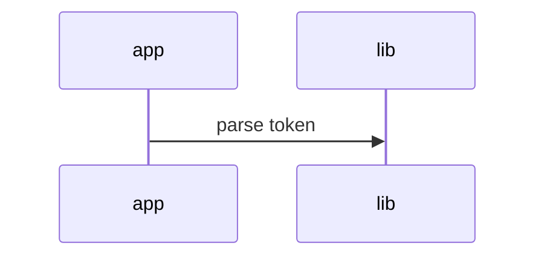

## Karandash Compliance: PASSED

### Changes Summary

Adds login.

Walkthrough

| Unit | Files | Lines |
|---|---|---|
| `app` | `src/main/Login.kt` | +10/-2 |
| `lib` | `src/Parser.kt` | +1/-1 |

| Severity | Count |
|----------|-------|
| Error | 0 |
| Warning | 1 |
| Info | 0 |

### Findings

| Severity | Rule | Message | How to fix |
|----------|------|---------|------------|
| ⚠️ WARNING | `r` | Null check missing |  |

### Compliance Checklist

---
_Generated by [karandash](https://github.com/karandash/karandash) · React 👎 on a finding to mark it as a false positive._
